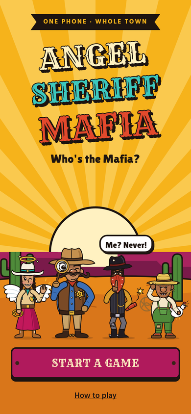
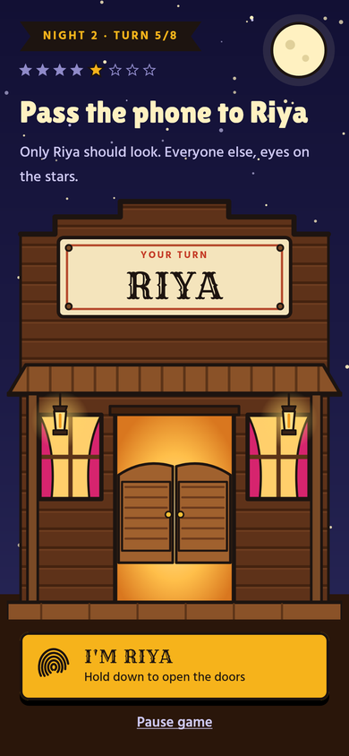
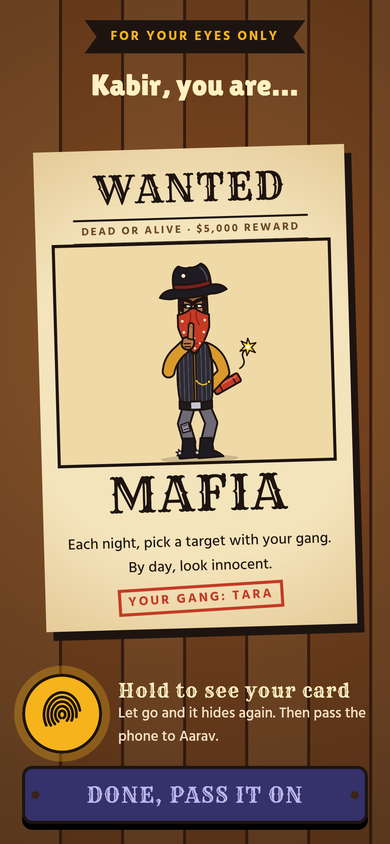
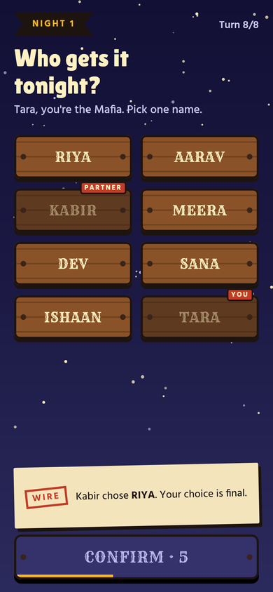
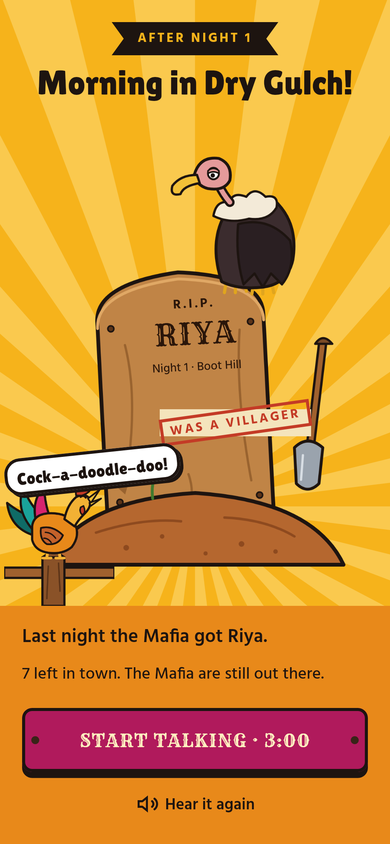
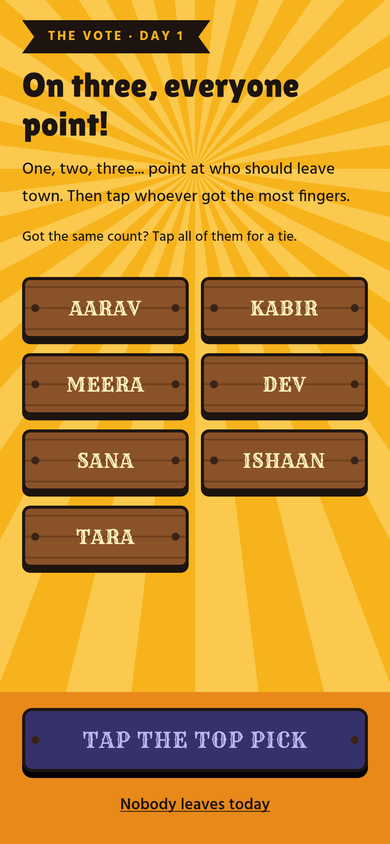
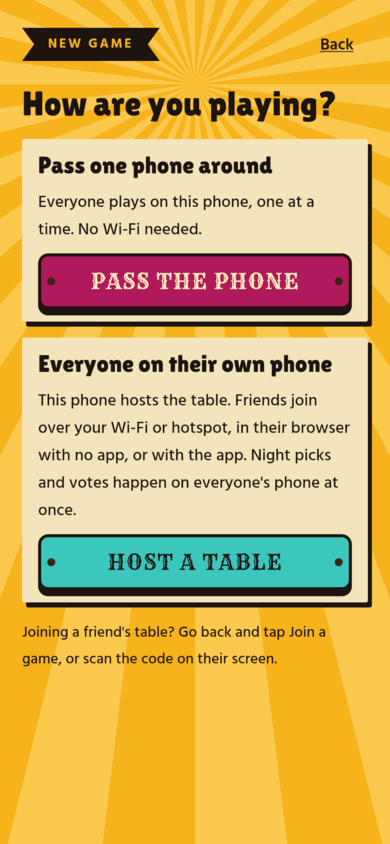
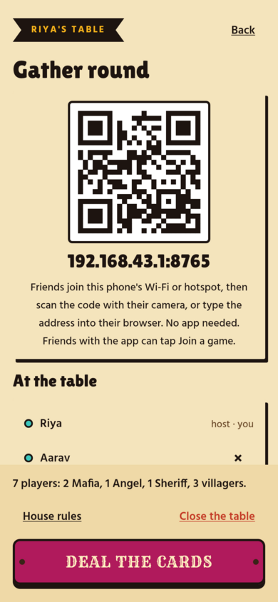
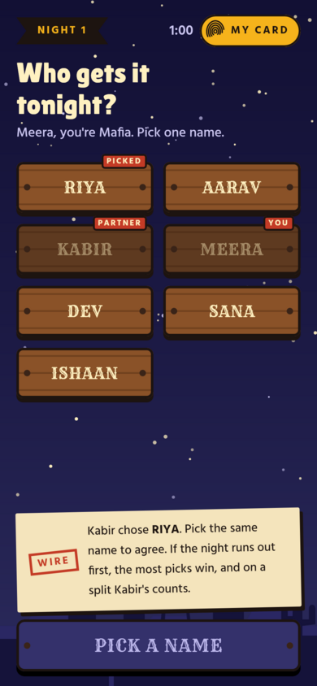
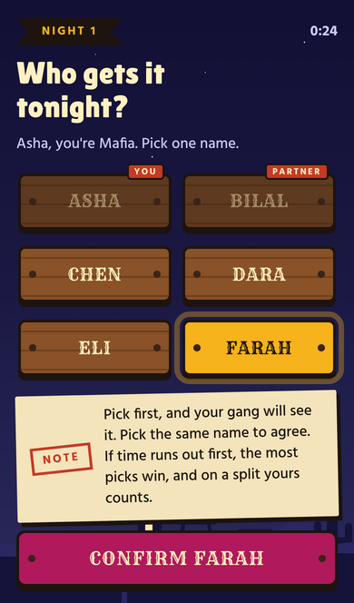

# Angel Sheriff Mafia

A Wild West party game of Mafia for Android. Play it on **one phone** passed round the
circle, or on **everyone's own phone** over the host's Wi-Fi or hotspot. The app deals the
roles, collects everyone's secret night moves, announces the morning out loud, runs the
vote and keeps score. Nobody has to sit out as the moderator, and nothing goes over the
internet.

<p>
  
  
  
  
  
  
</p>
<p>
  
  
  
  
</p>

## Two ways to play

- **Pass the phone.** One phone, passed round the circle. No Wi-Fi needed.
- **Host a table.** One phone hosts the game over its Wi-Fi or hotspot. Friends join the
  same Wi-Fi (or the host's hotspot) and scan the code on the host's screen:
  - in their phone's **browser**, with nothing to install, or
  - in the **app**, with *Join a game*. The app finds tables on the network by itself.

  Browser and app players can sit at the same table. Everyone sees their own role, makes
  their night pick and votes on their own phone, all at the same time. The host's phone
  runs the clock and the narrator, and the host can play too or just run the table. The
  join page also offers the host's own copy of the app to install.

## How a round works on one phone

1. **Set up.** Type everyone's names in seating order and pick house rules.
2. **Deal.** The phone goes round once. Each player holds their thumb down to see their
   wanted-poster role card.
3. **Night.** The phone goes round again. *Every* living player takes a turn on the same
   screen: the Mafia pick a target, the Angel protects, the Sheriff investigates, and
   villagers guess who the Mafia will go after. Each turn has a minimum time and a
   "pass to X" cover screen, so passing the phone gives nothing away.
4. **Morning.** Put the phone in the middle. The narrator says what happened.
5. **Discussion and vote.** A countdown, then an open vote (point on three) or a secret
   vote (pass the phone).
6. **Replay.** At the end, the app shows every move of the game.

The Mafia agree in turn: the first Mafia member on the phone picks, later ones see the
choice and can switch, and the last one decides. A different player starts each night,
so the final say moves around.

## How a round works on everyone's phone

1. **Open the table.** The host taps *New game*, then *Host a table*. Friends join until
   there are at least five, and the host deals.
2. **Deal.** Everyone holds their thumb down on their own phone to see their role card.
3. **Night.** Everyone picks at once, with a time limit set in the house rules. The Mafia
   see each other's picks live and lock in when they agree; if the night runs out first,
   the most-picked target is hit. Morning comes as soon as everyone has picked.
4. **Morning.** The host's phone says what happened, and every phone shows it.
5. **Discussion and vote.** A countdown on every phone, then everyone votes on their own
   phone. The house rules choose whether the result shows who voted for whom or only the
   count.
6. **Replay.** At the end, every phone shows every move of the game.

The table survives a phone locking or a browser tab reloading: each player gets their
seat back. If the host's app closes, *Back to the table* opens it again where it was.

## Project layout

| Module | What it is |
| --- | --- |
| `engine` | The game rules in pure Kotlin, with no Android code. One reducer: `Game.reduce(state, action)`. Fully unit-tested. |
| `lan` | Playing on everyone's own phone, in pure Kotlin: the host's table, a small web server for the local network, each player's view of the game (with everyone else's secrets left out) and the client the app joins with. Unit-tested. |
| `app` | The Android app: Jetpack Compose screens, ViewModels, the narrator, saved games, the hosting service and the browser page (`app/src/main/assets/web/`). |
| `preview` | A desktop harness that compiles the app's Compose screens without the Android SDK and renders screenshots of every screen. Optional. |

## Building

Requirements: JDK 17 and the Android SDK (API 36).

```sh
./gradlew :engine:test :lan:test   # rules and table tests
./gradlew :app:assembleDebug       # app/build/outputs/apk/debug/app-debug.apk
```

GitHub Actions builds the debug APK on every push and pull request and attaches it to
the run as an artifact. Each push to `main` also puts it on the GitHub release for its
version, `v<version>-debug` (for example `v0.2.0-debug`), as
`angel-sheriff-mafia-<version>-debug.apk`. A new `versionName` in `app/build.gradle.kts`
starts a new release; another push of the same version replaces that release's APK.

Debug builds are signed with the shared debug key in `app/debug.keystore`, so each new
build installs over the last one. (0.1.0 was signed with a different key: uninstall it
once before installing 0.2.0.) Debug keys are public: never use it for a store release.

Without the Android SDK you can still run the tests, render the screens and try the
browser page:

```sh
./gradlew -PengineOnly=true :engine:test :lan:test
./gradlew -PengineOnly=true -Ppreview=true :preview:run   # writes preview/out/*.png
./gradlew -PengineOnly=true :lan:demo                     # a table with bot players at http://localhost:8765
```

## Narrator

Narrator lines are designed to ship as recorded audio clips in
`app/src/main/assets/narrator/`. Until a clip is added, the phone's own text-to-speech
voice reads the line. Player names are always spoken by the on-device voice, with an
optional "say it like" spelling per player. At a hosted table, the host's phone is the
narrator. There are no API keys. See [docs/narrator-audio.md](docs/narrator-audio.md).

## Network

The app only talks to phones on the same Wi-Fi or hotspot, and only while a table is
open. The host's phone serves the game over plain HTTP on port 8765 (or the next free
one), and announces itself on the network as `_angelsheriff._tcp`. A phone only ever
receives its own secrets: its role, and for the Mafia and the Sheriff, what their role
lets them see. Everyone else's stay on the host. While a table is open, a notification
shows it, and the host's phone keeps its Wi-Fi awake so players can still reach it with
the screen off.

## Privacy on a shared phone

On one phone passed round:

- Secret screens only show behind a "pass to X" cover that the named player must hold to open.
- Role cards and the Sheriff's answer show only while a thumb is held down.
- Every role sees the same layout, timing, colours and sounds on its night turn.
- Screenshots and the recent-apps preview are blocked while the app is open.
- The game is saved after every move, so a locked screen or closed app loses nothing.

## Credits

Fonts are from Google Fonts under the SIL Open Font License: Rye (Sorkin Type), Lilita One
(Juan Montoreano) and Hind (Indian Type Foundry). Licences are in `licenses/`.
